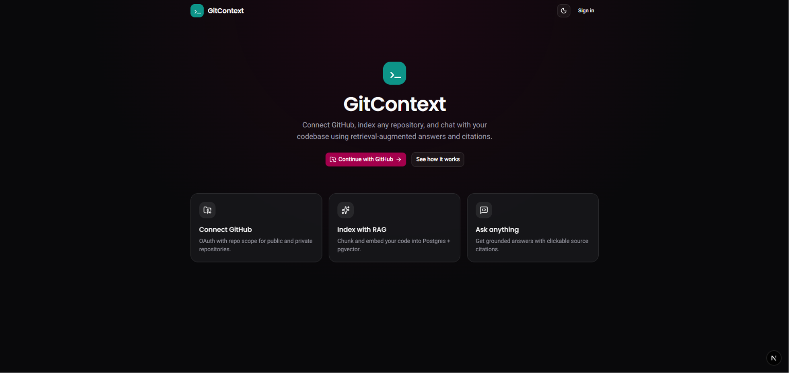
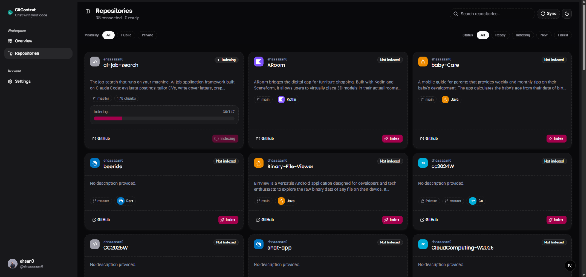
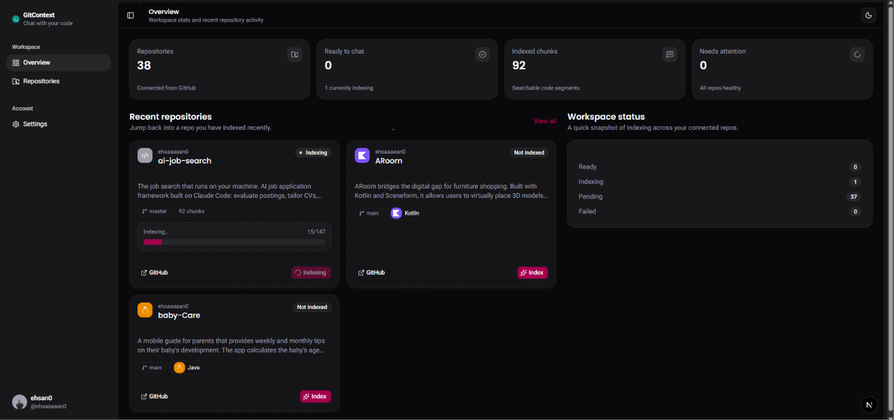
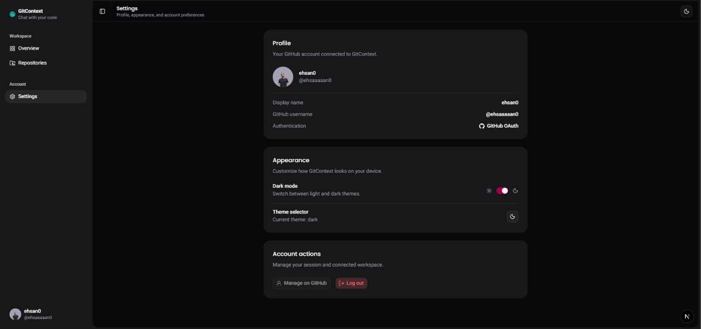

<div align="center">

# ⚡ GitContext

### *See Through Your Codebase with Semantic Clarity.*

An intelligent, full-stack codebase companion that bridges the gap between human intent and architectural complexity. **GitContext** indexes your GitHub repositories into high-dimensional vector space, empowering developers to navigate, explore, and converse with entire projects with line-level citation accuracy.

[](https://openjdk.org/)
[](https://spring.io/projects/spring-boot)
[](https://spring.io/projects/spring-ai)
[](https://nextjs.org/)
[](https://react.dev/)
[](https://tailwindcss.com/)
[](https://www.postgresql.org/)
[](https://github.com/pgvector/pgvector)
[](https://ai.google.dev/)

---

</div>

## 🌟 Philosophy

Modern software systems are vast, intricate, and continually evolving. Onboarding to unfamiliar repositories, diagnosing legacy patterns, and deciphering deep call hierarchies often requires hours of mental compilation.

**GitContext** eliminates that friction. By transforming raw source code into semantic embeddings stored inside a high-performance vector database, GitContext unlocks effortless conversation with your code. Rather than hallucinating or skimming surface-level snippets, it retrieves exact syntactic and contextual fragments, grounding every answer with verifiable file paths and line citations.

---

## 🚀 Key Highlights

- 🔐 **Seamless GitHub OAuth2 Integration** — One-click authentication with granular repo-read access, token encryption with AES/PBKDF2, and automatic repository discovery.
- 🧠 **Retrieval-Augmented Generation (RAG)** — Automated file tree ingestion, intelligent syntax filtering, sliding-window chunking, and 768-dimensional vector representations.
- ⚡ **Lightning-Fast Vector Search** — Powered by `pgvector` utilizing Hierarchical Navigable Small World (**HNSW**) indexing and cosine distance calculations.
- 🌊 **Real-Time Token Streaming** — Built on Server-Sent Events (SSE) with `SseEmitter` on Spring Boot and reactive client rendering for zero-latency typewriter responses.
- 📍 **Grounded Line-Level Citations** — Every explanation links directly to the corresponding source files, start lines, and end lines.
- 🎨 **Modern Ergonomic UI** — Built on Next.js 16 (App Router), React 19, Tailwind CSS v4, Base UI primitives, and dark/light adaptive themes.

---

## 📸 Screenshots

| Landing Experience | Repository Dashboard |
| :---: | :---: |
|  |  |
| *Modern landing page with single-click GitHub OAuth onboarding* | *Repository listing with real-time indexing status and sync triggers* |

| Repository Overview & Details | Profile & Account Settings |
| :---: | :---: |
|  |  |
| *Deep repository inspection, language distribution, and chat launcher* | *Secure credential management, session details, and theme customization* |

---

## 🏛️ Architecture & RAG Pipeline

```
                              ┌────────────────────────────────────────┐
                              │           GitHub Repositories          │
                              └───────────────────┬────────────────────┘
                                                  │ (OAuth2 Tree Fetch)
                                                  ▼
                                 ┌─────────────────────────────────┐
                                 │   Intelligent File Filtering    │
                                 │   (Skip Binaries, Locks, Min)   │
                                 └────────────────┬────────────────┘
                                                  │
                                                  ▼
                                 ┌─────────────────────────────────┐
                                 │       Code Chunking Engine      │
                                 │   (800-token chunks / 100 lap)  │
                                 └────────────────┬────────────────┘
                                                  │
                                                  ▼
                                 ┌─────────────────────────────────┐
                                 │ Google GenAI gemini-embedding-001 │
                                 │       (768 Dimensions)          │
                                 └────────────────┬────────────────┘
                                                  │
                                                  ▼
┌──────────────────┐             ┌─────────────────────────────────┐
│  Developer Chat  │────────────►│     PostgreSQL 16 + pgvector    │
│    (Next.js)     │             │     (HNSW Cosine Similarity)    │
└────────┬─────────┘             └────────────────┬────────────────┘
         ▲                                        │ (Top-K Code Chunks)
         │                                        ▼
         │  SSE Token Stream     ┌─────────────────────────────────┐
         └───────────────────────┤ Prompt Augmentation & Gemini 2.5│
                                 │       (Spring AI Engine)        │
                                 └─────────────────────────────────┘
```

---

## 🛠️ The Tech Stack

### Backend Engine
| Technology | Role & Purpose |
| :--- | :--- |
| **Java 25 / 26 LTS** | Harnessing latest JVM performance, Virtual Threads, and modern language features. |
| **Spring Boot 4.1.1** | The enterprise backbone providing robust web services, JPA orchestration, and security. |
| **Spring AI 2.0.1** | Native AI framework orchestrating Gemini ChatClient, embedding models, and VectorStore abstraction. |
| **Spring Security & OAuth2** | Zero-trust authentication flow with GitHub, PKCE verification, and encrypted token storage. |
| **Server-Sent Events (SSE)** | Reactive streaming pipeline delivering incremental AI tokens directly to the client browser. |
| **Hibernate & JPA** | Object-relational mapping managing session states, indexing status, and message histories. |

### Vector Database & Data Layer
| Technology | Role & Purpose |
| :--- | :--- |
| **PostgreSQL 16** | Reliable relational foundation managing accounts, synced repos, chat sessions, and audit logs. |
| **pgvector** | Native vector extension storing 768-dimensional embeddings with an **HNSW** index for sub-millisecond retrieval. |
| **Docker Compose** | Declarative container configuration with pre-installed vector extensions and persistent volume mounts. |

### Frontend Experience
| Technology | Role & Purpose |
| :--- | :--- |
| **Next.js 16.4 (App Router)** | Hybrid rendering with Turbopack for instantaneous hot-reloads and lightning-fast page transitions. |
| **React 19.3** | Utilizing the latest React concurrency primitives, actions, and server-side streaming features. |
| **Tailwind CSS v4** | Next-generation CSS engine with optimized design tokens and theme-aware styling. |
| **Base UI (`@base-ui/react`)** | Unstyled, accessible component primitives created by the Material UI team. |
| **TanStack React Query v5** | Declarative server-state synchronization with automatic background caching and refetching. |
| **Streamdown & Lucide** | High-fidelity markdown formatting, syntax highlighting, and minimal SVG icons. |

---

## 📁 Project Structure

```bash
gitcontext/
├── backend/                       # Spring Boot 4 Application
│   ├── src/main/java/app/backend/
│   │   ├── config/                # Security, CORS, Crypto, & Vector Store configs
│   │   ├── controllers/           # REST endpoints (Auth, Repo, Chat)
│   │   ├── entity/                # JPA Models (User, Repository, ChatSession, Message)
│   │   ├── repository/            # Spring Data JPA repositories
│   │   ├── security/              # GitHub OAuth2 UserService & Security context
│   │   └── services/
│   │       ├── ai/                # ChatPromptBuilder, CitationMapper, StreamHandler
│   │       ├── github/            # Rate-limited GitHub REST API client
│   │       └── indexing/          # CodeChunker, FileFilter, pgvector IndexingService
│   ├── src/main/resources/        # application.properties
│   └── pom.xml                    # Maven configuration with Spring AI & Boot 4
│
├── client/                        # Next.js 16 Front-End Application
│   ├── app/
│   │   ├── auth/callback/         # GitHub OAuth2 return handler
│   │   ├── chat/[repoId]/         # Codebase chat workspace & interactive citations
│   │   ├── dashboard/             # Repositories overview, sync status, and indexing
│   │   └── login/                 # Sign-in portal
│   ├── components/
│   │   ├── chat/                  # Chat session, message bubbles, citation drawer
│   │   ├── dashboard/             # Repo cards, index progress monitors
│   │   └── ui/                    # Base UI & Radix-compatible component primitives
│   ├── hooks/                     # Custom auth & chat state hooks
│   └── lib/                       # API clients, query keys, and utils
│
├── docker/                        # Database initialization scripts
│   └── postgres/init-extensions.sql # Automated vector, hstore, and uuid extension setup
└── docker-compose.yml             # Single-command local infrastructure
```

---

## ⚡ Quickstart Guide

### 1. Prerequisites
- **Java 25+** (Temurin / Oracle JDK)
- **Node.js 20+** & `npm`
- **Docker & Docker Compose**
- **GitHub OAuth App Credentials** ([Create one here](https://github.com/settings/developers))
  - *Authorization callback URL*: `http://localhost:8080/login/oauth2/code/github`
- **Google Gemini API Key** ([Get your key here](https://aistudio.google.com/app/apikey))

---

### 2. Start PostgreSQL with pgvector

Launch the database container with the vector extension automatically enabled:

```bash
docker compose up -d
```

---

### 3. Configure the Backend

Create or update `backend/.env` (or set system environment variables):

```env
# Database
DB_URL=jdbc:postgresql://localhost:5433/admin
DB_USERNAME=admin
DB_PASSWORD=admin

# AI & Gemini
GEMINI_API_KEY=your-gemini-api-key-here

# GitHub OAuth2
GITHUB_CLIENT_ID=your-github-client-id
GITHUB_CLIENT_SECRET=your-github-client-secret

# Frontend URL
FRONTEND_URL=http://localhost:3000
CORS_ALLOWED_ORIGINS=http://localhost:3000

# Security Encryption (Local Dev Defaults)
TOKEN_ENCRYPTOR_PASSWORD=your-secret-encryption-password
TOKEN_ENCRYPTOR_SALT=deadbeefcafebabe
```

Run the Spring Boot application:

```bash
cd backend
./mvnw spring-boot:run
```

*The backend will be listening on `http://localhost:8080`.*

---

### 4. Configure & Launch the Frontend

```bash
cd client
npm install
npm run dev
```

*The frontend will be live on `http://localhost:3000`.*

---

## 🔒 Security & Privacy

- **Encrypted Access Tokens**: GitHub personal access and OAuth tokens are never stored in plaintext. They are encrypted at rest using AES-CBC encryption with salted password derivation before persisting to PostgreSQL.
- **Stateless AI Processing**: Gemini is used strictly for on-demand vector embeddings and retrieval synthesis. Your code is not shared with third-party training pipelines.
- **Granular Scopes**: OAuth authorization requests are limited strictly to `read:user` and `repo` permissions necessary for indexing code trees.

---

<div align="center">

Crafted with dedication for developers who believe understanding code should feel as intuitive as writing it.

**[GitContext](https://github.com/your-username/gitcontext)** — *Precision Codebase Intelligence.*

</div>

